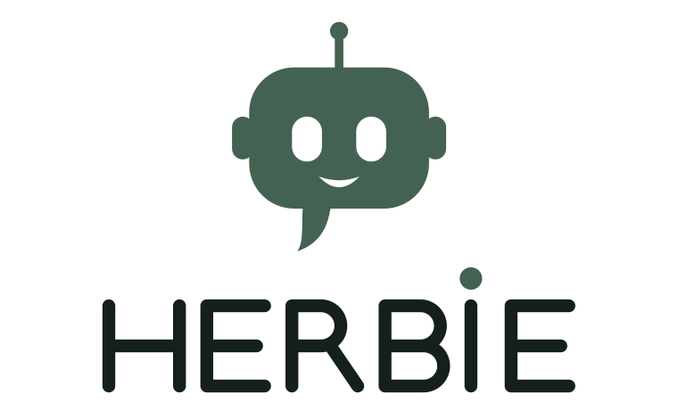

<div align="center">

<p>
  <picture>
    <source media="(prefers-color-scheme: dark)" srcset="docs/assets/logo-lockup-dark.svg" />
    
  </picture>
</p>

**The free, self-hosted open alternative to ChatGPT Plus and Claude Pro.**  
Built for developers and power users who want multi-model freedom, visual workflow automation, 1-click MCP apps, custom API tools, and production-grade RAG without vendor lock-in.

[](LICENSE)
[](https://go.dev/)
[](https://react.dev/)
[](https://www.typescriptlang.org/)
[](https://tailwindcss.com/)
[](deploy/docker-compose.yml)

[Why Herbie?](#why-herbie) • [Architecture](#architecture) • [Quickstart](#quickstart) • [Integrations](#optional-integrations) • [Contributing](CONTRIBUTING.md)

</div>

---

## Why Herbie?

SaaS AI subscriptions lock you into a single provider, hide token costs, silo your documents, and limit your automation abilities. **Herbie** gives you back full control with an interface that matches the polish of commercial chat apps while running entirely on your infrastructure.

Under the hood, Herbie pairs a high-concurrency Go backend powered by [golem](https://github.com/abubakarsiddik31/golem) with an instant React 19 + TypeScript frontend.

| Capability | What It Delivers | Highlights & Details |
|---|---|---|
| **⚡ Multi-Model Chat** | Per-thread model selection across cloud providers or local models | Google Gemini, OpenAI, Anthropic Claude, or local Ollama/vLLM endpoints; custom temperature & system prompts |
| **📁 Project Workspaces** | Scoped workspaces with isolated knowledge and custom guidelines | Dedicated chat threads, persistent reference docs, and automatic context injection |
| **⚡ Visual Workflows** | Node-based automation canvas powered by `@xyflow/react` | Webhook triggers, universal HTTP requests, LLM transformations, and branch logic |
| **🤖 Agent Tool Bridge** | Seamless integration between workflows and conversational chat | "Expose as Agent Tool" allows the chat assistant to autonomously execute workflows |
| **🛠️ Custom API Tools** | Register HTTP APIs with typed parameters and safety controls | 18 pre-built templates, SSRF DNS protection, and interactive Approve/Deny approval cards |
| **🔌 Curated MCP Apps** | 1-click integrations via standard Model Context Protocol (MCP) | GitHub, Slack, Google Calendar, Web Reader, Code Sandbox, and custom external MCP servers |
| **📚 Production RAG** | Hybrid vector + keyword retrieval with listwise LLM re-ranking | Ingest PDF, DOCX, MD, and TXT via Weaviate & MinIO with verified inline bracket citations `[n]` |
| **📊 Micro-USD Metering** | Granular sub-cent cost tracking across models and runs | Per-run token counters, 5-decimal USD ledger ($0.00001), and 30-day burn charts |
| **🎙️ Multimodal & Voice** | Vision attachment input and client-side speech-to-text | Up to 4 image attachments per prompt; native browser Web Speech API dictation |
| **🔒 Privacy & Security** | Self-hosted control running entirely on your infrastructure | In-memory access tokens, HttpOnly rotating refresh cookies, and AES-256-GCM vault encryption |
| **🤝 Always-On Bots** | Teammates that keep working when you close the tab | Per-bot model & instructions, background tasks with approvals, cron routines, and a private workspace |

---

## Architecture

```text
┌──────────────────────────────────────────────────────────────────────────┐
│                         Browser (React 19 SPA)                           │
│     Vite · Tailwind CSS v4 · Zustand (In-Memory Auth) · @xyflow/react     │
└─────────────────────────────────┬────────────────────────────────────────┘
                                  │ REST /api/* + Server-Sent Events (SSE)
                                  ▼
┌──────────────────────────────────────────────────────────────────────────┐
│                         Herbie Go Backend                                │
│       net/http · Golem Agent Engine · Vault Encryption · SafeHTTP SSRF    │
└──────────────┬──────────────────┬──────────────────┬─────────────────────┘
               │                  │                  │
               ▼                  ▼                  ▼
      ┌────────────────┐  ┌──────────────┐  ┌──────────────────┐
      │   PostgreSQL   │  │   Weaviate   │  │      MinIO       │
      │ Users, History │  │ Vector Store │  │ Original Uploads │
      │  Usage Ledger  │  │ Hybrid Index │  │  Object Storage  │
      └────────────────┘  └──────────────┘  └──────────────────┘
               │
               ▼
┌──────────────────────────────────────────────────────────────────────────┐
│                    External Providers & APIs                             │
│       Gemini · OpenAI · Claude · Tavily · Brave · Custom Webhooks        │
└──────────────────────────────────────────────────────────────────────────┘
```

---

## Quickstart

### Prerequisites
- [Docker & Docker Compose](https://docs.docker.com/get-docker/)
- [Go 1.23+](https://go.dev/dl/)
- [Node.js 20+](https://nodejs.org/) & `npm`

### 1. Clone & Configure
```bash
git clone https://github.com/abubakarsiddik31/herbie.git
cd herbie

cp .env.example .env
```

Open `.env` and add your model provider key (at minimum, a free Google Gemini key):
```env
GEMINI_API_KEY=your_gemini_api_key_here
```

### 2. Start Core Infrastructure
Start PostgreSQL (mapped to port 5433 to avoid conflicts with existing local instances):
```bash
make up
```

### 3. Run the Stack

**Terminal 1 — Backend:**
```bash
make backend
# Running at http://localhost:8080
```

**Terminal 2 — Frontend:**
```bash
make frontend
# Running at http://localhost:5173
```

Open [http://localhost:5173](http://localhost:5173) in your browser and create your account.

---

## Optional Integrations

### Social Login (Google & GitHub)
Add your OAuth client credentials in `.env`:
```env
OAUTH_GOOGLE_CLIENT_ID=your_google_client_id
OAUTH_GOOGLE_CLIENT_SECRET=your_google_client_secret

OAUTH_GITHUB_CLIENT_ID=your_github_client_id
OAUTH_GITHUB_CLIENT_SECRET=your_github_client_secret
```
Callback URLs to register in Google/GitHub developer consoles:
- Google: `http://localhost:8080/api/auth/oauth/google/callback`
- GitHub: `http://localhost:8080/api/auth/oauth/github/callback`

### Enable Production RAG
Spin up Weaviate and MinIO via the `rag` Docker profile:
```bash
docker compose -f deploy/docker-compose.yml --profile rag up -d
```
Then set in `.env`:
```env
RAG_ENABLED=true
```

### Web Search Providers
Configure your preferred search engine in `.env`:
```env
# Option A: Built-in local Wigolo container (zero API keys needed)
WEB_SEARCH_PROVIDER=wigolo
WIGOLO_URL=http://localhost:3333

# Option B: Tavily API
WEB_SEARCH_PROVIDER=tavily
TAVILY_API_KEY=tvly-your_key_here

# Option C: Brave Search API
WEB_SEARCH_PROVIDER=brave
BRAVE_API_KEY=BSA-your_key_here
```

---

## Bots (always-on teammates)

Bots are persistent, always-on teammates with their own identity, instructions, model, and emoji. Each bot picks its own model (Gemini, OpenAI, Claude, or local), so you can pair a cheap model for routine chores with a frontier model for hard tasks.

- **Live chat** — talk to a bot directly; its instructions and persona apply to every conversation.
- **Background tasks** — ask a bot to do long-running work (web research, multi-step tool calls). Runs execute in the background with live run cards, activity traces, and cancellable queues. Destructive tool calls (e.g. `delete_file`) park the run in `waiting_approval` until you approve or deny it.
- **Routines** — attach cron schedules (`*/5 * * * *`) that fire tasks automatically; results land in the bot's conversation.
- **Workspace files & memory** — bots read and write files in their own workspace (e.g. `findings.md`) and remember facts across conversations.

Tuning knobs (see `.env.example`): `BOT_RUNNER_ENABLED`, `BOT_RUNNER_CONCURRENCY`, `BOT_RUNNER_POLL_MS`, `BOT_ROUTINE_TICK_MS`, `MAX_BOTS_PER_USER`, `MAX_ROUTINES_PER_BOT`, `BOT_FILE_MAX_BYTES`.

---

## Testing & Quality Gates

Herbie enforces strict quality gates across both backend and frontend.

```bash
# Run backend tests & checks (offline with mock fixtures)
make check

# Run frontend lint, typecheck, and unit test suite
make fe-check

# Run end-to-end smoke test against a live instance
scripts/smoke.sh
```

---

## Project Structure

```text
├── backend/
│   ├── cmd/server/             # HTTP server entrypoint
│   └── internal/
│       ├── auth/               # Password hashing, JWT maker, refresh rotation
│       ├── chat/               # Golem agent orchestration & catalog
│       ├── httpapi/            # REST API handlers, middleware, SSE streams
│       ├── mcp/                # Model Context Protocol client & catalog
│       ├── rag/                # Chunker, vector embeddings, reranker
│       ├── storage/            # PostgreSQL migrations & repositories
│       ├── vault/              # AES-GCM credential encryption
│       ├── websearch/          # Wigolo, Tavily, Brave search adapters
│       └── workflow/           # Visual canvas workflow evaluation engine
├── frontend/
│   ├── src/
│   │   ├── components/         # UI primitives, layout, sidebar, CodeBlock
│   │   ├── features/           # Auth, chat, documents, MCP, workflows
│   │   ├── pages/              # Chat, Projects, Workflows, Tools, Usage
│   │   ├── stores/             # Zustand in-memory auth & session store
│   │   └── lib/                # API client, types, utils, SSE parser
├── deploy/
│   └── docker-compose.yml      # PostgreSQL, Weaviate, MinIO, Wigolo
├── Makefile                    # Standard developer tasks
└── Dockerfile                  # Multi-stage production container build
```

---

## Contributing

We welcome contributions from the open-source community! Please review our [Contributing Guide](CONTRIBUTING.md) and [Code of Conduct](CODE_OF_CONDUCT.md) before submitting pull requests.

---

## License

Herbie is open-source software licensed under the [MIT License](LICENSE).
